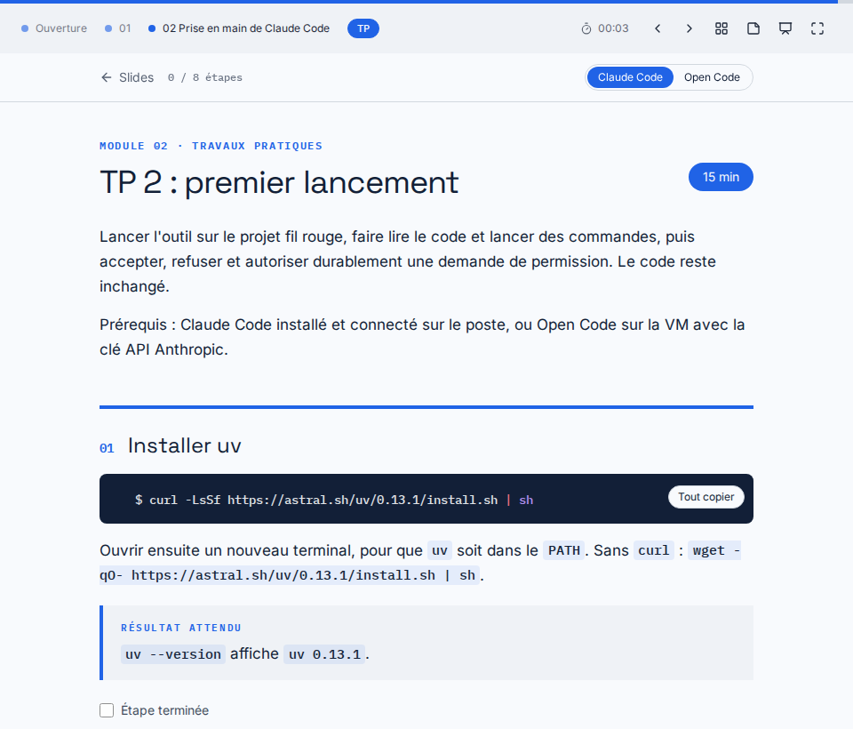

# Ouverture

## Développer avec Claude Code / Open Code {.title kicker="Formation"}

Maîtriser les fondamentaux, puis l'usage en équipe

::: notes
Accueil, horaires, pauses, tour de table : attentes, outils déjà utilisés.
:::

## Programme {.agenda}

::: notes
Ordre des modules : comprendre le modèle, prendre l'outil en main, puis l'adapter au projet et à l'équipe.
:::

## Quatre demi-journées {kicker="Organisation"}

| Demi-journée | Modules | TP |
|---|---|---|
| 1 | 01 à 04 : LLM, prise en main, exploration, génération et tests | TP 2 à 4 |
| 2 | 05 : prompting, CLAUDE.md, mémoire et contexte | TP 5 |
| 3 | 06 : skills, slash commands et hooks | TP 6 |
| 4 | 07 : livrable documentaire avec pandoc | TP 7 |

Chaque demi-journée dure 3 h 30. Le TP d'un module ferme ce module.

::: notes
Modules 1 à 4 : introduction, aucun sujet approfondi. Pas de TP au module 1.
Le temps annoncé peut déborder si le contenu l'exige.
:::

## Deux outils, deux environnements {.compare kicker="Organisation"}

::: claude-code
Sur le poste du développeur, déjà installé et connecté.

```console
$ claude --version
```
:::

::: opencode
Sur la VM, avec une clé API Anthropic personnelle.

```console
$ opencode --version
```
:::

::: notes
Chaque TP se fait avec l'un ou l'autre outil ; l'énoncé donne les instructions des deux quand elles diffèrent.
Installation et authentification de Claude Code : montrées au module 2, pas réalisées.
Claude Code sur la VM : prévu quand la VM aura évolué.
Vérifier dès maintenant que chacun lance son outil ; un problème de clé se règle avant le TP 2.
:::

## Un modèle pour toute la formation {kicker="Organisation"}

| Nom donné à l'outil | Modèle obtenu sur l'API Anthropic |
|---|---|
| `claude-sonnet-4-6` | Claude Sonnet 4.6, toujours le même |
| `sonnet` | Claude Sonnet 5.5 aujourd'hui, puis la Sonnet suivante |

Démonstrations et TP utilisent `claude-sonnet-4-6`. Les sorties et les limites montrées sont celles de ce modèle.

::: sources
- [Claude Code, Model configuration : Model aliases](https://code.claude.com/docs/en/model-config#model-aliases)
- [Claude Platform, Models overview](https://platform.claude.com/docs/en/about-claude/models/overview)
- [Claude Platform, Model deprecations : Model status](https://platform.claude.com/docs/en/about-claude/model-deprecations#model-status)
:::

::: notes
« Aliases point to the recommended version for your provider and update over time. » Sur Bedrock ou Google Cloud, `sonnet` désigne Sonnet 4.5 ; sur Claude Platform on AWS, Sonnet 4.6.
Depuis la génération 4.6, chaque identifiant sans date est un instantané figé.
Sonnet 4.6 : modèle « legacy », encore disponible, état Active ; retrait pas avant le 17 février 2027.
Réglage du modèle dans chaque outil : module 2. Open Code : le `opencode.json` du fil rouge le fixe déjà.
:::

## Le projet fil rouge {kicker="Fil rouge"}

```text
rooms/
  main.py        application FastAPI
  routes.py      salles, réservations, planning
  schemas.py     schémas Pydantic
  models.py      Room, Booking, BookingError
  db.py          connexion et schéma sqlite3
  repository.py  requêtes SQL
  conflicts.py   chevauchement de créneaux
  pricing.py     calcul du tarif
  export.py      planning en CSV
  seed.py        données de démonstration
```

API de réservation de salles de réunion en Python 3.14, gérée par uv : environ 430 lignes de code et 240 lignes de tests.

::: notes
Domaine compris sans explication métier. Code, champs JSON et messages d'erreur en anglais.
Le code a des défauts voulus : `pricing.py` sans test, conventions écrites nulle part. Ne pas les révéler maintenant, les TP 4 et 5 les font découvrir.
uv installe lui-même Python 3.14 : la VM a Python 3.10.
:::

## Une copie, du TP 2 au TP 6 {kicker="Fil rouge"}


::: notes
Terminer chaque TP avant le suivant : pas d'état intermédiaire fourni.
Chaque TP qui modifie le code finit par un commit. `git diff` compare son état au corrigé ; un TP raté se reprend depuis le commit précédent.
Le TP 7 (pandoc) est indépendant du fil rouge.
:::

## Le support et le projet dans une archive {kicker="Fil rouge"}

```console
$ unzip ~/Documents/claude-code.zip -d ~
```

L'archive contient ce support, `claude-code.html`, et le projet `fil-rouge/`. Le TP 2 l'extrait, après l'installation de uv.

::: notes
Sans `unzip` : `python3 -m zipfile -e ~/Documents/claude-code.zip ~` (Python 3.10 présent sur la VM).
Claude Code sur le poste : l'archive est sur la VM, la copier sur le poste avant le TP 2 (`scp`, hôte communiqué en séance).
Le support s'ouvre en double-cliquant sur `claude-code.html`, sans serveur.
:::

## Les TP dans le support {kicker="Support"}

La pastille « TP » ouvre l'énoncé du module en cours, à lire en demi-écran à côté du terminal.

L'outil se choisit une fois pour tous les TP. Chaque étape se coche, chaque bloc se copie.

|||



::: notes
Navigation : flèches, G vue d'ensemble, N notes, F plein écran, Échap revient aux slides.
Les choix (outil, étapes cochées) restent dans le navigateur.
Les notes d'animation sont visibles par tous (touche N).
:::
