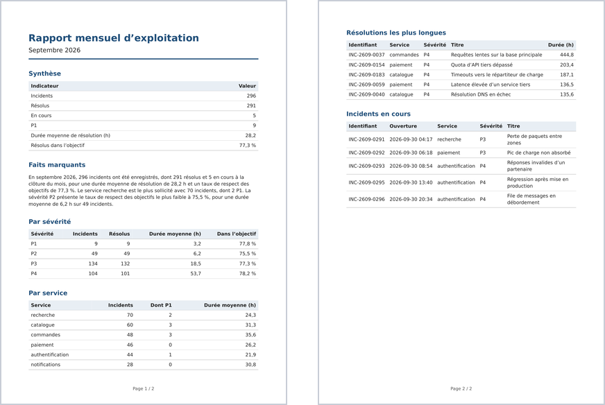

# Cas d'usage : livrable documentaire avec pandoc

Produire un PDF reproductible à partir d'une source texte

::: notes
Module 7, 3h30 : 1h15 de slides et de démonstrations, 1h45 de TP (7A et 7B en parallèle, une moitié des groupes chacun), 30 min de restitution comparée.
Notions déjà vues, à ne pas redéfinir : `claude -p` (module 2), boucle de vérification (module 4), coût d'une session et `/usage` (module 5), slash commands et partage des extensions (module 6).
Cinq parties : piloter la production, la chaîne Markdown → HTML → PDF, template et CSS paginée, documents générés depuis des données, industrialisation.
Le TP est indépendant du fil rouge.
:::

## pandoc convertit un document d'un format à un autre {.figures kicker="Notions"}

- **47** formats en lecture
- **67** formats en écriture
- **35** formats dans les deux sens

Markdown, HTML, LaTeX et docx se lisent et s'écrivent. Le PDF s'obtient en écriture seulement.

::: sources
- [pandoc, User's Guide : Description](https://pandoc.org/MANUAL.html#description)
- `pandoc --list-input-formats`, `pandoc --list-output-formats` (pandoc 3.7.0.2)
:::

::: notes
Manuel : « Pandoc is a Haskell library for converting from one markup format to another, and a command-line tool that uses this library. »
Comptes relevés le 18 octobre 2026 sur pandoc 3.7.0.2 ; les versions d'Ubuntu (2.9.2.1, 3.1.3) en ont moins.
Fonctionnement interne (lecteurs, arbre, écrivains) : slide « pandoc passe par une représentation commune ».
:::

## Les quatre pièces de la chaîne {.facts kicker="Notions"}

- **pandoc** convertit un document d'un format à un autre
- **Template** squelette de la page, où pandoc insère le contenu
- **CSS paginée** feuille de style qui décrit des pages imprimées
- **WeasyPrint** transforme du HTML et sa CSS en PDF

::: sources
- [pandoc, User's Guide : Description](https://pandoc.org/MANUAL.html#description)
- [pandoc, User's Guide : Templates](https://pandoc.org/MANUAL.html#templates)
- [WeasyPrint](https://doc.courtbouillon.org/weasyprint/stable/#weasyprint)
- [W3C, CSS Paged Media Module Level 3](https://www.w3.org/TR/css-page-3/)
:::

::: notes
pandoc : « a Haskell library for converting from one markup format to another, and a command-line tool that uses this library. »
Templates : « When the -s/--standalone option is used, pandoc uses a template to add header and footer material that is needed for a self-standing document. »
WeasyPrint : « a visual rendering engine for HTML and CSS that can export to PDF. It aims to support web standards for printing. » Aucun JavaScript : « there is no user-interaction, no JavaScript, no live rendering ».
CSS paginée : module CSS Paged Media du W3C ; WeasyPrint en annonce toutes les fonctions (slide « Le format de la page : @page »).
Chaque pièce a sa partie : pandoc et WeasyPrint dans la deuxième, template et CSS dans la troisième.
:::

## L'agent écrit, convertit, relit {kicker="Piloter"}


::: sources
- [Claude Code, Best practices : Give Claude a way to verify its work](https://code.claude.com/docs/en/best-practices#give-claude-a-way-to-verify-its-work)
:::

::: notes
Même boucle qu'au module 4 (rassembler, agir, vérifier), appliquée à un document : la vérification porte sur le PDF au lieu d'une suite de tests.
Doc : « Give Claude something that produces a pass or fail, and the loop closes on its own. Claude does the work, runs the check, reads the result, and iterates until the check passes. »
L'agent lance pandoc par son outil shell : la commande doit être autorisée (module 2).
:::

## La source est un fichier texte {kicker="Piloter"}

```markdown
## Synthèse

| Indicateur | Valeur |
|---|---:|
| Incidents | 296 |
| Résolus dans l'objectif | 77,3 % |
```

Le Markdown se relit en diff et se versionne avec git. Le PDF se régénère depuis lui.

::: sources
- [pandoc, User's Guide : Pandoc's Markdown](https://pandoc.org/MANUAL.html#pandocs-markdown)
- Corrigé du TP 7B : Markdown écrit par `tp/tp07-pandoc/corrige-7b/rapport.py`
:::

::: notes
Extrait réduit du Markdown produit au TP 7B (illustration de la forme, chiffres réels du mois de septembre).
Un Word ou un PDF édité à la main ne se compare pas en diff ; une correction du Markdown se relit comme une correction de code.
L'agent écrit ce format sans outil particulier : ses outils d'édition suffisent.
:::

## L'agent lit le PDF qu'il produit {.compare kicker="Piloter"}

::: claude-code
Read lit un PDF court en entier. Au-delà de 10 pages, il lit par plages de 20 pages au plus, rendues en images par `pdftoppm`.
:::

::: opencode
`read` transmet le PDF entier au modèle, sans plage de pages, jusqu'à 20 Mio.
:::

::: sources
- [Claude Code, Tools reference : Read tool behavior](https://code.claude.com/docs/en/tools-reference#read-tool-behavior)
- Open Code v2.0.26 : [`tool/read-filesystem.ts`](https://github.com/anomalyco/opencode/blob/v2.0.26/packages/core/src/tool/read-filesystem.ts), [`session/model-request.ts`](https://github.com/anomalyco/opencode/blob/v2.0.26/packages/core/src/session/model-request.ts)
:::

::: notes
Doc Claude Code : « Claude reads short `.pdf` files whole. For PDFs longer than 10 pages, it reads in ranges with a `pages` parameter, such as `"1-5"`, up to 20 pages at a time. Page-range reads render pages with `pdftoppm` from poppler-utils ». Sans `pdftoppm` : erreur `pdftoppm is not installed`.
Open Code v2.0.26 : fichier transmis comme `application/pdf`, refusé si le modèle ne déclare pas l'entrée `pdf` ; models.dev la déclare pour `claude-sonnet-4-6`. Non documenté en v1.
Le rapport du TP fait deux pages : lecture entière dans les deux outils.
Détail dans `formateur/equivalences.md`, section « Coût et lecture de PDF ».
:::

## Vérifier contre une grille écrite {kicker="Piloter"}

```prompt
Lis rapport.pdf et vérifie-le avec grille.md, critère par critère.
Pour chaque critère, réponds respecté ou non respecté, et cite la page qui le prouve.
```

Une grille écrite donne à l'agent des critères vérifiables. « Vérifie que le PDF est correct » ne lui en donne aucun.

::: sources
- [Claude Code, Best practices : Give Claude a way to verify its work](https://code.claude.com/docs/en/best-practices#give-claude-a-way-to-verify-its-work)
- Grille du TP : `tp/tp07-pandoc/grille.md`
:::

::: notes
Prompt d'illustration, à jouer en démonstration sur le PDF du corrigé.
Doc : « Claude stops when the work looks done. Without a check it can run, "looks done" is the only signal available, and you become the verification loop ».
La grille du TP compte 13 critères : structure, chiffres, faits marquants, mise en page. Elle sert aussi aux groupes pour noter leur propre PDF.
Rappel module 5 : le verbe décide de l'action ; « vérifie » sans « corrige » laisse l'agent rapporter sans corriger.
Les chiffres se contrôlent contre les valeurs de référence (`preparation/references.md`), que l'agent n'a pas.
:::

## Chaque relecture coûte des tokens {.compare kicker="Piloter"}

::: claude-code
`/usage` : coût estimé de la session et tokens par modèle.
:::

::: opencode
Sous la zone de saisie et dans le panneau latéral « Context » : tokens et « $x spent ».
:::

::: sources
- [Claude Code, Manage costs : Using the /usage command](https://code.claude.com/docs/en/costs#using-the-usage-command)
- Open Code v2.0.26 : [`prompt/footer.tsx`](https://github.com/anomalyco/opencode/blob/v2.0.26/packages/tui/src/feature-plugins/prompt/footer.tsx), [`sidebar/context.tsx`](https://github.com/anomalyco/opencode/blob/v2.0.26/packages/tui/src/feature-plugins/sidebar/context.tsx)
:::

::: notes
Chaque tour de la boucle relit le PDF : son contenu entre dans le contexte à chaque lecture.
Doc : « Claude Code computes the dollar figure locally from token counts at list price ». Avec un abonnement Pro ou Max, le montant n'a pas de valeur de facturation.
Le TP relève ce coût pour la production initiale et pour le mois suivant : préparer la lecture du chiffre dans chaque outil.
`opencode stats --cost` agrège par période et par projet, pas par session.
:::

## Un PDF se vérifie contre une grille écrite. {.statement kicker="Idée clé"}

::: notes
Découle de « L'agent écrit, convertit, relit », « L'agent lit le PDF qu'il produit » et « Vérifier contre une grille écrite ».
Transition : la conversion elle-même, de la source au PDF.
:::

## De la source au PDF {kicker="Chaîne"}


::: sources
- [pandoc, User's Guide : Creating a PDF](https://pandoc.org/MANUAL.html#creating-a-pdf)
:::

::: notes
« pandoc can use ConTeXt, roff ms, or HTML as an intermediate format. […] The tool used to generate the PDF from the intermediate format may be specified using --pdf-engine. »
« When HTML is used as an intermediate format, the output can be styled using --css. »
Le HTML intermédiaire reste dans un fichier temporaire : une seule commande pandoc produit le PDF.
:::

## pandoc passe par une représentation commune {kicker="Chaîne"}

Un lecteur analyse le format d'entrée et produit un arbre du document. Un écrivain convertit cet arbre dans le format de sortie.

```console
$ pandoc rapport.md -o rapport.html
$ pandoc rapport.md -o rapport.docx
```

::: sources
- [pandoc, User's Guide : Description](https://pandoc.org/MANUAL.html#description)
:::

::: notes
« it consists of a set of readers, which parse text in a given format and produce a native representation of the document (an abstract syntax tree or AST), and a set of writers, which convert this native representation into a target format. »
« one should not expect perfect conversions between every format and every other. »
Le format de sortie se déduit de l'extension de `-o` ; `-t` le force.
:::

## Le PDF passe par HTML et CSS {kicker="Chaîne"}

Par défaut, pandoc produit un PDF avec LaTeX. Avec `--pdf-engine=weasyprint`, il produit du HTML, que WeasyPrint met en page selon la CSS.

La mise en page s'écrit alors en CSS, sans installer LaTeX.

::: sources
- [pandoc, User's Guide : Creating a PDF](https://pandoc.org/MANUAL.html#creating-a-pdf)
- [pandoc, User's Guide : --pdf-engine](https://pandoc.org/MANUAL.html#option--pdf-engine)
:::

::: notes
« By default, pandoc will use LaTeX to create the PDF, which requires that a LaTeX engine be installed ».
Moteurs HTML cités par le manuel : weasyprint (défaut pour `-t html`), prince, wkhtmltopdf, pagedjs-cli.
`pandoc` et `weasyprint` s'installent par apt (slide « Installer pandoc et WeasyPrint »).
:::

## La commande, option par option {kicker="Chaîne"}

```console
$ pandoc rapport.md -s --template template.html --css rapport.css --wrap=none --pdf-engine=weasyprint -o rapport.pdf
```

| Option | Rôle |
|---|---|
| `-s` | document complet, avec `<head>`, et non un fragment |
| `--template` | squelette de la page ; implique `-s` |
| `--css` | lien vers la feuille de style, dans l'en-tête |
| `--wrap=none` | aucune coupure de ligne dans le HTML produit |

::: sources
- [pandoc, User's Guide : --standalone](https://pandoc.org/MANUAL.html#option--standalone), [--template](https://pandoc.org/MANUAL.html#option--template), [--css](https://pandoc.org/MANUAL.html#option--css), [--wrap](https://pandoc.org/MANUAL.html#option--wrap)
:::

::: notes
`--css` : « It should be used together with -s/--standalone, because the link to the stylesheet goes in the document header. »
`--template` : « Implies --standalone. » Sans `--template`, pandoc prend son template par défaut.
`--wrap=none` : sans lui, pandoc 3.1.3 (Ubuntu 24.04) coupe le `<title>` à 72 colonnes, et WeasyPrint 61.1 ne garde que la première ligne dans le titre du PDF (constaté le 18 octobre 2026, `formateur/equivalences.md`).
`--pdf-engine=weasyprint` : sans lui, pandoc passe par LaTeX.
Commande du Makefile du corrigé 7B.
:::

## Les métadonnées en tête du Markdown {kicker="Chaîne"}

```yaml
---
title: Rapport mensuel d'exploitation
subtitle: Septembre 2026
lang: fr
---
```

Un bloc YAML en tête du fichier. Chaque champ devient une variable du template.

::: sources
- [pandoc, User's Guide : YAML metadata block](https://pandoc.org/MANUAL.html#extension-yaml_metadata_block)
- [pandoc, User's Guide : Metadata variables](https://pandoc.org/MANUAL.html#metadata-variables)
:::

::: notes
« A YAML metadata block is a valid YAML object, delimited by a line of three hyphens (---) at the top and a line of three hyphens (---) or three dots (...) at the bottom. »
« Template variables will be set automatically from the metadata. »
Un titre qui contient deux-points se met entre guillemets (règles d'échappement YAML).
`lang` : le template par défaut l'écrit dans `<html lang="…">` (`pandoc -D html`, ligne 2).
:::

## Les tableaux Markdown {kicker="Chaîne"}

```markdown
| Sévérité | Incidents | Dans l'objectif |
|---|---:|---:|
| P1 | 9 | 77,8 % |
```

Les deux-points de la ligne de séparation alignent la colonne : `---:` à droite, `:---:` au centre.

::: sources
- [pandoc, User's Guide : Pipe tables](https://pandoc.org/MANUAL.html#extension-pipe_tables)
:::

::: notes
« The colons indicate column alignment as shown. The header cannot be omitted. »
« The cells of pipe tables cannot contain block elements like paragraphs and lists, and cannot span multiple lines. »
Chiffres alignés à droite : les unités et les décimales tombent les unes sous les autres.
Piège des largeurs de colonnes : slide « Des colonnes de même largeur ».
:::

## Installer pandoc et WeasyPrint {kicker="Chaîne"}

```console
$ sudo apt install pandoc weasyprint
```

| Distribution | pandoc | WeasyPrint |
|---|---|---|
| Ubuntu 22.04 | 2.9.2.1 | 54.1 |
| Ubuntu 24.04 | 3.1.3 | 61.1 |

Ces versions produisent toutes deux le PDF du TP.

::: sources
- [pandoc, Installing](https://pandoc.org/installing.html)
- [WeasyPrint, First steps](https://doc.courtbouillon.org/weasyprint/stable/first_steps.html)
- Essais du 18 octobre 2026 : `formateur/equivalences.md`
:::

::: notes
Testé dans les images Docker `ubuntu:22.04` et `ubuntu:24.04` : table des matières, tableaux, accents, saut de page, pied de page « Page n / total ». Le corrigé 7B rend à l'identique sous Ubuntu 22.04.
macOS : `brew install pandoc weasyprint`. Windows : `winget install --source winget --exact --id JohnMacFarlane.Pandoc` et l'exécutable WeasyPrint des releases GitHub.
Pour que Claude Code lise un PDF de plus de 10 pages : `poppler-utils`.
:::

## pandoc convertit, la CSS met en page, WeasyPrint imprime. {.statement kicker="Idée clé"}

::: notes
Découle de « De la source au PDF » et de « Le PDF passe par HTML et CSS » : chaque outil a un rôle, et la mise en page vit dans un fichier CSS.
Transition : écrire ce template et cette CSS.
:::

## Le template : du HTML avec des variables {kicker="Template et CSS"}

```html
<h1>$title$</h1>
<p class="mois">$subtitle$</p>
$body$
```

`$title$` reçoit le champ `title` des métadonnées, `$body$` le document converti.

::: sources
- [pandoc, User's Guide : Interpolated variables](https://pandoc.org/MANUAL.html#interpolated-variables)
- [pandoc, User's Guide : Variables set automatically](https://pandoc.org/MANUAL.html#variables-set-automatically)
:::

::: notes
« A slot for an interpolated variable is a variable name surrounded by matched delimiters. » Délimiteurs : `$…$` ou `${…}`.
`body` : « body of document », variable fixée par pandoc.
Une variable absente des métadonnées se donne aussi en ligne de commande : `-V nom=valeur`.
:::

## Conditions et boucles {kicker="Template et CSS"}

```html
$if(subtitle)$<p class="mois">$subtitle$</p>$endif$
$for(css)$<link rel="stylesheet" href="$css$">$endfor$
```

`$if$` n'insère le bloc que si la variable existe. `$for$` le répète pour chaque valeur : une par option `--css`.

::: sources
- [pandoc, User's Guide : Conditionals](https://pandoc.org/MANUAL.html#conditionals)
- [pandoc, User's Guide : For loops](https://pandoc.org/MANUAL.html#for-loops)
:::

::: notes
« The if section is used if variable has a true value, otherwise the else section is used (if present). »
« If variable is an array, the material inside the loop will be evaluated repeatedly, with variable being set to each value of the array in turn ».
`--css` « can be used repeatedly to include multiple files » : d'où la boucle.
:::

## Le template du rapport {kicker="Template et CSS"}

```html file="../tp/tp07-pandoc/corrige-7b/template.html" lines="5-15"
```

::: sources
- Corrigé du TP 7B : `tp/tp07-pandoc/corrige-7b/template.html`
:::

::: notes
Extrait : manquent le `<!DOCTYPE>`, `<html lang="$lang$">` et les balises de fermeture.
Écrit par l'agent au TP 7B. Le `<title>` réunit titre et mois : il devient le titre du PDF (`pdfinfo rapport.pdf`).
Les deux syntaxes vues : variables, boucle `$for(css)$`.
Pas de `$if$` : le script écrit toujours `subtitle`.
:::

## Partir du template par défaut {kicker="Template et CSS"}

```console
$ pandoc -D html > template.html
```

Le template par défaut de pandoc contient déjà les métadonnées, la langue et les styles de base. On le copie, puis on le modifie.

::: sources
- [pandoc, User's Guide : --print-default-template](https://pandoc.org/MANUAL.html#option--print-default-template)
:::

::: notes
« Print the system default template for an output FORMAT. »
« some of the default templates use partials, for example styles.html. To print the partials, use --print-default-data-file ».
Le template par défaut varie d'une version de pandoc à l'autre : en extraire un depuis le pandoc de la VM, pas depuis celui du poste.
Le template du corrigé est plus court que celui par défaut : la CSS du projet remplace les styles intégrés.
:::

## Le format de la page : @page {kicker="Template et CSS"}

```css
@page {
  size: A4;
  margin: 2cm 1.8cm 2.2cm;
}
```

La règle `@page` fixe le format du papier et les marges de chaque page.

::: sources
- [WeasyPrint, Adjust document dimensions](https://doc.courtbouillon.org/weasyprint/stable/common_use_cases.html#adjust-document-dimensions)
- [WeasyPrint, CSS Paged Media Module Level 3](https://doc.courtbouillon.org/weasyprint/stable/api_reference.html#css-paged-media-module-level-3)
:::

::: notes
« WeasyPrint does not provide support for adjusting page size or document margins via command-line flags. This is best accomplished with the CSS @page at-rule ».
Exemple de la doc : `@page { size: A3 landscape; margin: 3cm }`. A4 portrait est le format par défaut.
Paged Media : « All the features of this draft are available, including: the @page rule and the :left, :right, :first and :blank selectors; the page margin boxes; the page-based counters ».
`@page :first` donne une première page différente (sans pied de page, par exemple).
Marges du corrigé : 2 cm en haut, 1,8 cm sur les côtés, 2,2 cm en bas pour le pied de page.
:::

## Numéroter les pages {kicker="Template et CSS"}

```css
@page {
  @bottom-center {
    content: "Page " counter(page) " / " counter(pages);
  }
}
```

`@bottom-center` désigne la marge du bas, au centre. `counter(page)` donne le numéro de la page, `counter(pages)` le nombre total.

::: sources
- [W3C, CSS Paged Media : Page-margin boxes](https://www.w3.org/TR/css-page-3/#margin-boxes)
- [W3C, CSS Paged Media : Page-based counters](https://www.w3.org/TR/css-page-3/#page-based-counters)
- [WeasyPrint, CSS Paged Media Module Level 3](https://doc.courtbouillon.org/weasyprint/stable/api_reference.html#css-paged-media-module-level-3)
:::

::: notes
Spécification : « A counter named page is automatically created and incremented by 1 on every page of the document » ; « a counter named pages is automatically created by the UA. Its value is always the total number of pages in the document. »
Seize boîtes de marge, de `@top-left-corner` à `@left-top` ; `@top-center` pour un en-tête.
La doc WeasyPrint dit seulement « the page-based counters (with known limitations #93) » ; le pied « Page n / total » est vérifié sur WeasyPrint 54.1, 61.1 et 70.0.
Règle complète, avec police, taille et couleur : `rapport.css` du corrigé, lignes 1 à 12.
La boîte de marge n'hérite pas de la police de `body` : la déclarer dans `@bottom-center` (constaté sur le corrigé, police à empattement sinon).
:::

## Contrôler les sauts de page {kicker="Template et CSS"}

```css
h2 { break-after: avoid; }
tr { break-inside: avoid; }
```

Un titre ne reste pas seul en bas de page, une ligne de tableau n'est pas coupée en deux. `break-before: page` force un saut.

::: sources
- [WeasyPrint, CSS Fragmentation Module Level 3/4](https://doc.courtbouillon.org/weasyprint/stable/api_reference.html#css-fragmentation-module-level-3-4)
:::

::: notes
« The break-before, break-after and break-inside properties are supported for pages, but not for columns and regions. page-break-* aliases as defined in CSS2 are supported too. »
Un tableau sur deux pages répète son en-tête (`<thead>`) : changelog de WeasyPrint 0.19.1, « repeat <thead> and <tfoot> elements on every page ». Constaté sur le PDF d'octobre du corrigé.
Usage courant de `break-before: page` : une section qui commence toujours sur une nouvelle page.
:::

## Des colonnes de même largeur {kicker="Template et CSS"}

Quand une ligne d'un tableau Markdown dépasse 72 caractères, pandoc fixe la largeur de chaque colonne d'après le nombre de tirets de la ligne de séparation. Avec `|---|---|`, toutes les colonnes ont la même largeur.

```css
col { width: auto !important; }
```

::: sources
- [pandoc, User's Guide : Pipe tables](https://pandoc.org/MANUAL.html#extension-pipe_tables)
- [pandoc, User's Guide : --wrap](https://pandoc.org/MANUAL.html#option--wrap)
:::

::: notes
« If any line of the Markdown source is longer than the column width (see --columns), then the table will take up the full text width and the cell contents will wrap, with the relative cell widths determined by the number of dashes in the line separating the table header from the table body. »
`--columns` vaut 72 par défaut (entrée `--wrap`).
Constaté sur le corrigé 7B : la colonne Titre des résolutions les plus longues coupée sur trois lignes. pandoc écrit `<col style="width: 20%" />` ; la règle CSS l'annule.
Autres corrections possibles : des tirets proportionnels aux largeurs voulues, ou `--columns` plus grand.
Exemple de défaut que l'agent voit en relisant le PDF, et qu'il corrige dans la CSS.
:::

## Le même Markdown donne toujours le même PDF. {.statement kicker="Idée clé"}

::: notes
Découle des slides sur le template et la CSS : la mise en page est dans deux fichiers versionnés, séparée du contenu.
Transition : quand le contenu vient lui-même de données.
:::

## Le rapport mensuel du TP {.figures kicker="Données"}

- **296** incidents en septembre
- **8** colonnes par incident
- **6** sections dans le rapport
- **13** critères dans la grille

Le mois suivant compte 336 incidents, avec les mêmes colonnes.

::: sources
- Données du TP : `tp/tp07-pandoc/donnees/incidents-2026-09.csv`, `incidents-2026-10.csv`
- Grille : `tp/tp07-pandoc/grille.md`
:::

::: notes
Données générées pour la formation par `preparation/generate_incidents.py`, avec une graine fixe : le script redonne les mêmes fichiers.
Colonnes : `id`, `ouverture`, `service`, `severite`, `categorie`, `titre`, `statut`, `duree_resolution_min`.
Sections : Synthèse, Faits marquants, Par sévérité, Par service, Résolutions les plus longues, Incidents en cours.
Valeurs de référence calculées par script : `preparation/references.md`.
:::

## Les données : un incident par ligne {kicker="Données"}

```csv file="../tp/tp07-pandoc/donnees/incidents-2026-09.csv" lines="1-3"
```

Huit colonnes : identifiant, date d'ouverture, service, sévérité, catégorie, titre, statut, durée de résolution en minutes.

::: sources
- Données du TP : `tp/tp07-pandoc/donnees/incidents-2026-09.csv`
:::

::: notes
Les deux premiers des 296 incidents de septembre.
Sévérité de P1 à P4. Statut `résolu` ou `en cours` ; un incident en cours n'a pas de durée.
Fichier en UTF-8, séparateur virgule, sans guillemets.
:::

## Le livrable : un PDF de deux pages {kicker="Données"}



::: sources
- Corrigé du TP 7B : `tp/tp07-pandoc/corrige-7b/rapport.pdf`
:::

::: notes
PDF du corrigé 7B, mois de septembre, WeasyPrint 70.
Six sections, dans l'ordre : Synthèse, Faits marquants, Par sévérité, Par service, Résolutions les plus longues, Incidents en cours.
Seuls les faits marquants sont rédigés ; le reste est fait de chiffres calculés sur le CSV.
Le PDF de l'approche directe a les mêmes sections : la grille est commune.
:::

## L'approche directe {kicker="Données"}


::: sources
- Énoncé du TP 7A, en fin de module
:::

::: notes
L'agent fait tout en conversation : lecture du CSV, calculs, rédaction, conversion, relecture.
Les calculs se font dans le raisonnement du modèle, ou dans des commandes que l'agent écrit à la volée : l'énoncé ne l'impose pas.
TP 7A.
:::

## L'approche outillée {kicker="Données"}


::: sources
- Corrigé du TP 7B : `tp/tp07-pandoc/corrige-7b/`
:::

::: notes
L'agent écrit le script, ses tests, le template, la CSS et le Makefile. Il n'écrit pas le rapport lui-même.
Le script est testé contre les valeurs de référence (`tests/test_rapport.py`).
TP 7B.
:::

## Ce que le TP compare {kicker="Données"}

| Question | Mesurée par |
|---|---|
| Combien de temps pour le premier rapport ? | chronomètre |
| Combien de tokens ? | `/usage`, zone de saisie d'Open Code |
| Combien de prompts ? | décompte du groupe |
| Les chiffres sont-ils justes ? | grille, valeurs de référence |

Chaque question se pose deux fois : pour le premier mois, puis pour le mois suivant.

::: sources
- Grille : `tp/tp07-pandoc/grille.md`
:::

::: notes
L'approche qui correspond à la pratique est donnée avant le TP (slide « Un rapport récurrent s'outille ») ; la restitution la confronte aux relevés des groupes.
Questions à garder pour la restitution : qui a calculé les chiffres, comment le groupe les a vérifiés, ce qu'a coûté le mois suivant.
:::

## L'agent rédige à partir des chiffres calculés {kicker="Données"}

```json
"synthese": {
  "incidents": 296,
  "duree_moyenne_h": 28.2,
  "taux_objectif_pct": 77.3
}
```

Le script calcule les agrégats. L'agent rédige les faits marquants à partir d'eux, sans relire le CSV.

::: sources
- Corrigé du TP 7B : `tp/tp07-pandoc/corrige-7b/faits.json`, `faits.md`
:::

::: notes
Extrait réduit des agrégats de septembre (`faits.json`, 3,3 Ko, contre 30 Ko pour le CSV).
Faits marquants obtenus le 18 octobre 2026 (Claude Code v2.1.302, `claude-sonnet-4-6`) : « Le service recherche est le plus sollicité avec 70 incidents, dont 2 P1. La sévérité P2 présente le taux de respect des objectifs le plus faible à 75,5 % ». Chiffres exacts.
Le prompt demande de recopier les chiffres sans en calculer de nouveaux : chaque chiffre cité se vérifie dans le JSON.
Approche hybride : le script pour les calculs, le modèle pour la rédaction.
:::

## Deux approches, un livrable, une grille commune. {.statement kicker="Idée clé"}

::: notes
Découle de « L'approche directe », « L'approche outillée » et « Ce que le TP compare ».
Ce qui les distingue en pratique vient après l'industrialisation, avant le lancement du TP.
:::

## Un Makefile enchaîne les étapes {kicker="Industrialisation"}


make reconstruit un fichier quand l'un de ceux dont il dépend est plus récent que lui.

::: sources
- [GNU make, How make Processes a Makefile](https://www.gnu.org/software/make/manual/make.html#How-make-Processes-a-Makefile)
- Corrigé du TP 7B : `tp/tp07-pandoc/corrige-7b/Makefile`
:::

::: notes
Manuel : « The recompilation must be done if the source file, or any of the header files named as prerequisites, is more recent than the object file, or if the object file does not exist. »
Un changement de `rapport.css` ne relance que pandoc ; un nouveau CSV relance le script, puis pandoc.
`make` sans argument construit la première cible du fichier : « This is called the default goal. » Dans le corrigé, `all`, qui dépend de `rapport.pdf`.
Commandes exactes : `uv run rapport.py agregats incidents.csv build/agregats.json`, `uv run rapport.py markdown build/agregats.json faits.md build/rapport.md`.
`agregats.json` : tous les chiffres des tableaux, calculés par le script (slide « L'agent rédige à partir des chiffres calculés »).
:::

## faits.md : le seul texte rédigé par l'agent {kicker="Industrialisation"}

> En septembre 2026, 296 incidents ont été enregistrés, dont 291 résolus et 5 en cours à la clôture du mois, pour une durée moyenne de résolution de 28,2 h et un taux de respect des objectifs de 77,3 %. Le service recherche est le plus sollicité avec 70 incidents, dont 2 P1. La sévérité P2 présente le taux de respect des objectifs le plus faible à 75,5 %, pour une durée moyenne de 6,2 h sur 49 incidents.

Le script l'insère tel quel sous le titre « Faits marquants ».

::: sources
- Corrigé du TP 7B : `tp/tp07-pandoc/corrige-7b/faits.md`, `rapport.py`
:::

::: notes
Contenu intégral de `faits.md` pour septembre, produit par `make faits` le 18 octobre 2026 (Claude Code, `claude-sonnet-4-6`).
Chaque chiffre se retrouve dans `agregats.json` : l'agent recopie, le script calcule.
Versionné : un nouvel appel au modèle donnerait un autre texte.
`faits.json` : copie des agrégats d'où vient ce texte, pour détecter un `faits.md` périmé.
:::

## Une règle : cible, dépendances, commande {kicker="Industrialisation"}

```makefile file="../tp/tp07-pandoc/corrige-7b/Makefile" lines="22-23"
```

`build/agregats.json` est la cible, `$(CSV)` et `rapport.py` ses dépendances. La ligne suivante, indentée par une tabulation, la produit.

::: sources
- [GNU make, What a Rule Looks Like](https://www.gnu.org/software/make/manual/make.html#What-a-Rule-Looks-Like)
- [GNU make, Automatic Variables](https://www.gnu.org/software/make/manual/make.html#Automatic-Variables)
:::

::: notes
« A target is usually the name of a file that is generated by a program » ; « A prerequisite is a file that is used as input to create the target. » ; « A recipe is an action that make carries out. »
« you need to put a tab character at the beginning of every recipe line! » Des espaces donnent l'erreur `missing separator`.
`$@` : « The file name of the target of the rule. » `$<` : « The name of the first prerequisite. »
Chaque ligne de commande tourne dans son propre shell ; un `$` destiné au shell s'écrit `$$`.
`.PHONY` : cibles qui ne sont pas des fichiers (`all`, `faits`, `clean`), exécutées à chaque demande.
:::

## Appeler l'agent sans session {.compare kicker="Industrialisation"}

::: claude-code
```console
$ claude -p "/faits-marquants" < build/agregats.json
```

La slash command est développée, l'entrée standard s'ajoute au prompt.
:::

::: opencode
```console
$ opencode run "<prompt>" < build/agregats.json
```

`/faits-marquants` n'est pas développé : le Makefile envoie le texte de la commande.
:::

::: sources
- [Claude Code, Headless : Pipe data through Claude](https://code.claude.com/docs/en/headless#pipe-data-through-claude), [Create a commit](https://code.claude.com/docs/en/headless#create-a-commit)
- Open Code v2.0.26 : [`run/run.ts`](https://github.com/anomalyco/opencode/blob/v2.0.26/packages/cli/src/run/run.ts), [`prompt/parse.ts`](https://github.com/anomalyco/opencode/blob/v2.0.26/packages/tui/src/prompt/parse.ts)
:::

::: notes
Claude Code : « User-invoked skills and custom commands work. Include `/skill-name` in the prompt string and Claude Code expands it before running. » ; « Non-interactive mode reads stdin, so you can pipe data in and redirect the response out like any other command-line tool. »
Open Code v2.0.26 : seule la TUI analyse les `/` (`parse.ts`) ; `opencode run` envoie le texte brut, et l'option `--command` de la doc v1 n'existe plus. L'entrée standard est ajoutée au message (`mergeInput`). Constaté le 18 octobre 2026.
Commande complète du Makefile : `opencode run -m anthropic/claude-sonnet-4-6 "$$(awk 'f >= 2; /^---$$/ { f++ }' .opencode/commands/faits-marquants.md)"` (corps du fichier sans son frontmatter).
Réponse seule sur stdout dans les deux outils ; les traces d'Open Code vont sur stderr.
Rappel module 6 : `claude -p` lance les hooks du dépôt sans demander la confiance du dossier.
:::

## L'appel au modèle a sa propre cible {kicker="Industrialisation"}

```console
$ make faits
$ make
```

`make faits` appelle le modèle une fois par mois de données. `make` reconstruit le PDF sans l'appeler, après un changement de CSS par exemple.

::: sources
- Corrigé du TP 7B : `tp/tp07-pandoc/corrige-7b/Makefile`
:::

::: notes
Coût mesuré le 18 octobre 2026 : 0,09 $ pour un `make faits` (`claude -p --output-format json`, champ `total_cost_usd`), dont l'essentiel en écriture de cache du contexte de départ.
`faits.json` garde les agrégats d'où vient `faits.md` : si le CSV change sans `make faits`, `make` s'arrête avec « faits.md was written for other data: run make faits ».
Un appel au modèle ne redonne pas deux fois le même texte : le séparer garde le PDF reproductible tant que les données ne changent pas.
:::

## Ce qui se versionne {kicker="Industrialisation"}

| Fichier | Versionné |
|---|---|
| script, tests, template, CSS, Makefile | oui |
| commande `faits-marquants`, `faits.md` | oui |
| `build/`, `rapport.pdf` | non, régénérés par `make` |

::: sources
- Corrigé du TP 7B : `tp/tp07-pandoc/corrige-7b/.gitignore`
:::

::: notes
`faits.md` est versionné : c'est un texte rédigé, que `make` ne régénère pas.
Le PDF se régénère depuis le dépôt ; le livrer est une étape de publication, hors de git.
:::

## Une commande partagée avec le projet {kicker="Industrialisation"}

```markdown file="../tp/tp07-pandoc/corrige-7b/.claude/commands/faits-marquants.md" lines="1-6"
```

Commitée avec le projet, elle sert au Makefile comme à une session interactive.

::: sources
- [Claude Code, Skills : Where skills live](https://code.claude.com/docs/en/skills#where-skills-live)
- Corrigé du TP 7B : `.claude/commands/` et `.opencode/commands/`
:::

::: notes
Rappel module 6 : `.claude/commands/<nom>.md` est l'ancien emplacement des slash commands, toujours lu ; même fichier dans `.opencode/commands/`.
Extrait : suivent quatre règles (deux à quatre phrases, service et sévérité à citer, chiffres recopiés sans calcul, paragraphe seul sans outil).
Pas de `$ARGUMENTS` : les agrégats arrivent par l'entrée standard.
« Use no tool » : la commande n'a besoin d'aucune permission, condition d'un appel sans surveillance.
:::

## Ce qui se refait chaque mois passe dans le Makefile. {.statement kicker="Idée clé"}

::: notes
Découle de « Un Makefile enchaîne les étapes » et de « L'appel au modèle a sa propre cible ».
Transition : laquelle des deux approches du TP correspond à la pratique.
:::

## Un rapport récurrent s'outille {kicker="Choisir"}

| | Approche directe | Approche outillée |
|---|---|---|
| Usage | document ponctuel, premier jet | rapport publié chaque mois |
| Chiffres | recalculés par l'agent chaque mois | calculés par un script testé |
| Mois suivant | une nouvelle session | `make faits`, puis `make` |

Un script redonne les mêmes chiffres. Deux appels identiques au modèle peuvent différer.

::: sources
- [Claude Platform, Glossary : Temperature](https://platform.claude.com/docs/en/about-claude/glossary#temperature)
- Corrigé du TP 7B : `tp/tp07-pandoc/corrige-7b/Makefile`
:::

::: notes
Glossaire : « Even with temperature set to 0, the results will not be fully deterministic and identical inputs may produce different outputs across API calls. » Rappel module 1, slide « Limites structurelles ».
Approche outillée : c'est l'organisation d'un rapport récurrent en production. Les chiffres viennent d'un code testé, identiques à chaque exécution et vérifiables ; le modèle ne rédige que les faits marquants, depuis des chiffres déjà calculés ; un mois coûte un appel au modèle.
Approche directe : utile pour un document qui ne reviendra pas, ou pour mettre au point la forme du rapport avant de l'outiller. Chaque mois, l'agent relit le CSV et refait les calculs : rien ne garantit les mêmes méthodes d'un mois à l'autre, et chaque chiffre se revérifie.
Le TP met cette recommandation à l'épreuve : les relevés des groupes (temps, coût, prompts, conformité) se comparent en restitution, surtout sur le mois suivant.
:::

## En production, le code calcule et le modèle rédige. {.statement kicker="Idée clé"}

::: notes
Découle de « Un rapport récurrent s'outille » et de « L'agent rédige à partir des chiffres calculés ».
Transition : les deux TP, chacun dans sa section. Une moitié des groupes fait le 7A, l'autre le 7B.
:::

## TP 7A : rapport mensuel, approche directe {.tp duration="1h45"}

Produire le rapport mensuel d'exploitation de septembre, puis d'octobre, à partir du CSV des incidents. L'agent écrit le rapport lui-même : il calcule les chiffres, écrit `rapport.md`, lance pandoc et relit le PDF, chaque mois dans une nouvelle session.

Cette approche convient à un document ponctuel ou à un premier jet. Les relevés se comparent avec ceux du TP 7B, qui outille le même rapport.

::: notes
Durées visées : 10 min pour l'installation et le dossier, 15 pour produire et faire vérifier septembre, 15 pour noter et relever, 15 pour octobre, 15 pour noter et relever, 35 de marge (attente des commandes, corrections, relecture des PDF).
Essai du 18 octobre 2026, Claude Code v2.1.302, `claude-sonnet-4-6`, prompts de l'énoncé en `claude -p` (relevé dans le corrigé). Septembre : chiffres exacts, calculés par un script Python passé à `python3` sans fichier. Défaut du premier PDF : titre affiché deux fois (titre des métadonnées et titre `#` du Markdown). L'agent avait annoncé 13 critères respectés en contrôlant `rapport.md` par un script, sans lire le PDF ; le prompt de vérification lui fait lire le PDF et corriger.
Octobre : 12 sur 13. Deux durées des résolutions les plus longues fausses d'un dixième (163,2 au lieu de 163,3, 147,9 au lieu de 148,0) : `round` de Python n'arrondit pas au demi supérieur. L'agent a lu le PDF et déclaré les 13 critères respectés. Exemple à garder pour la restitution : l'agent vérifie avec la méthode qui a produit l'erreur, seule la comparaison aux références la voit.
L'énoncé laisse l'agent libre de sa méthode de calcul. S'il écrit un script dans un fichier et le réutilise en octobre, le groupe glisse vers l'approche outillée : le noter pour la restitution.
Faits marquants : l'agent ajoute volontiers une interprétation (« tension structurelle sur l'infrastructure ») que les chiffres ne portent pas. Le critère 12 ne la pénalise pas ; en parler en restitution.
:::

### Installer pandoc et WeasyPrint

uv est installé depuis le TP 2. Sur la VM, l'installation demande le droit `sudo`.

```console
$ sudo apt install pandoc weasyprint
$ pandoc --version
$ weasyprint --version
```

::: attendu
Sous Ubuntu 22.04 : `pandoc 2.9.2.1` et `WeasyPrint version 54.1`. Ces versions, et les suivantes, produisent le PDF du TP.
:::

::: indice
Sur le poste : macOS, `brew install pandoc weasyprint` ; Windows, `winget install --source winget --exact --id JohnMacFarlane.Pandoc` et l'exécutable WeasyPrint des [releases GitHub](https://github.com/Kozea/WeasyPrint/releases).
:::

### Préparer le dossier

```console
$ mkdir ~/rapport
$ cd ~/rapport
$ cp ~/pandoc/incidents-2026-09.csv incidents.csv
$ cp ~/pandoc/grille.md ~/pandoc/opencode.json .
```

Lire `grille.md` : colonnes du CSV, règles de calcul, 13 critères. `~/pandoc/references.md` donne les valeurs attendues, pour la notation : il reste hors du dossier, l'agent ne doit pas le lire.

::: claude-code
```console
$ claude --permission-mode acceptEdits --model claude-sonnet-4-6
```

Accepter le dossier quand Claude Code le demande.
:::

::: opencode
```console
$ opencode
```
:::

::: attendu
Le dossier contient `incidents.csv`, `grille.md` et `opencode.json`. Claude Code : la barre d'état affiche `⏵⏵ accept edits on`. Open Code : le modèle Claude Sonnet 4.6 est affiché.
:::

### Produire le rapport de septembre

Noter l'heure : le relevé de temps part de ce prompt.

```prompt
<context>
incidents.csv : les incidents de septembre 2026, un par ligne. grille.md : le contenu attendu du rapport mensuel d'exploitation, ses règles de calcul et sa mise en page.
</context>
<instructions>
Produis rapport.pdf, le rapport de septembre 2026 conforme à grille.md. Écris la source dans rapport.md et la mise en page dans rapport.css, puis convertis avec :
pandoc rapport.md -s --css rapport.css --wrap=none --pdf-engine=weasyprint -o rapport.pdf
</instructions>
<verification>
Relis rapport.pdf et vérifie chaque critère de grille.md. Corrige et reconvertis tant qu'un critère échoue.
</verification>
```

Accepter les commandes de calcul et `pandoc`.

::: attendu
L'agent lit `incidents.csv` et `grille.md`, calcule les chiffres, souvent par un script Python lancé sans fichier, écrit `rapport.md` et `rapport.css`, puis lance `pandoc`. `rapport.pdf` existe. L'agent annonce les critères respectés.
:::

### Faire vérifier le PDF

```prompt
Lis rapport.pdf et vérifie-le avec grille.md, critère par critère. Pour chaque critère, réponds respecté ou non respecté, et cite la page qui le prouve. Corrige ensuite les critères non respectés et tout défaut de mise en page visible, puis reconvertis.
```

Ouvrir ensuite le PDF :

```console
$ xdg-open rapport.pdf
```

::: attendu
Un tableau des 13 critères, une page citée pour chacun. Un contrôle fait sur `rapport.md` ne voit pas le rendu : ce prompt fait lire le PDF lui-même. Défaut fréquent corrigé à cette étape : le titre affiché deux fois. Noter l'heure : le temps de septembre s'arrête ici.
:::

### Noter et relever septembre

Noter le PDF critère par critère avec `grille.md` et la section Septembre de `~/pandoc/references.md` : 1 point par critère entièrement respecté.

::: claude-code
Coût : `/usage`, ligne `Total cost`.
:::

::: opencode
Coût : montant `$… spent` sous la zone de saisie.
:::

| Mois | Temps (min) | Coût ($) | Prompts | Critères (sur 13) |
|---|---:|---:|---:|---:|
| Septembre | | | | |
| Octobre | | | | |

Les prompts comptés sont ceux qui ont été tapés, réponses aux demandes de permission exclues.

::: attendu
La ligne Septembre est remplie. Un écart avec `references.md` se note comme critère non respecté, même si l'agent l'a déclaré respecté.
:::

### Produire le rapport d'octobre

Quitter l'outil. Un mois plus tard, la conversation de septembre est fermée : le rapport d'octobre se fait dans une nouvelle session.

```console
$ cp ~/pandoc/incidents-2026-10.csv incidents.csv
```

::: claude-code
```console
$ claude --permission-mode acceptEdits --model claude-sonnet-4-6
```
:::

::: opencode
```console
$ opencode
```
:::

Noter l'heure, puis :

```prompt
<context>
incidents.csv contient maintenant les incidents d'octobre 2026. rapport.md, rapport.css et rapport.pdf sont le rapport de septembre.
</context>
<instructions>
Produis le rapport d'octobre 2026 conforme à grille.md : mets à jour rapport.md, puis reconvertis avec :
pandoc rapport.md -s --css rapport.css --wrap=none --pdf-engine=weasyprint -o rapport.pdf
</instructions>
<verification>
Lis rapport.pdf et vérifie-le avec grille.md, critère par critère, en citant la page qui le prouve. Corrige et reconvertis tant qu'un critère échoue.
</verification>
```

::: attendu
L'agent relit `grille.md` et le nouveau CSV, refait les calculs, met à jour `rapport.md`, reconvertit et rend un tableau des 13 critères. Les chiffres changent : 336 incidents, service paiement le plus touché. Rien ne garantit que les calculs suivent la même méthode qu'en septembre : chaque chiffre se recontrôle à la notation. Noter l'heure à la fin.
:::

### Noter et relever octobre

Noter le PDF avec la section Octobre de `~/pandoc/references.md`, puis relever le coût de cette nouvelle session comme pour septembre et remplir la ligne Octobre.

::: attendu
Le tableau est complet. Garder `rapport.pdf` et le tableau pour la restitution.
:::

### Corrigé {.corrige}

Les prompts de l'énoncé sont les prompts types. Le Markdown obtenu à l'essai pour septembre, après la vérification du PDF : le titre est écrit en `#` et n'est plus répété par les métadonnées.

```markdown file="../tp/tp07-pandoc/corrige-7a/rapport-2026-09.md" lines="1-18"
```

Le PDF attendu a les chiffres de `~/pandoc/references.md` ; ses faits marquants et sa mise en page varient d'un essai à l'autre. Essai d'octobre, dans une nouvelle session : deux durées sont fausses d'un dixième.

```markdown file="../tp/tp07-pandoc/corrige-7a/rapport-2026-10.md" lines="46-52"
```

163,25 h doit s'arrondir à 163,3 selon les règles de `grille.md`. Le script de l'agent arrondit par `round` de Python, qui donne 163,2. L'agent a vérifié le PDF et déclaré les 13 critères respectés : il contrôle avec la méthode qui a produit l'erreur.

Relevé de l'essai, prompts joués en `claude -p`, sans temps de lecture humain :

| Mois | Temps (min) | Coût ($) | Prompts | Critères (sur 13) |
|---|---:|---:|---:|---:|
| Septembre | 5 | 0,96 | 2 | 13 |
| Octobre | 3 | 0,59 | 1 | 12 |

## TP 7B : rapport mensuel, approche outillée {.tp duration="1h45"}

Produire le même rapport avec des outils que l'agent écrit une fois : un script testé calcule les chiffres, un Makefile enchaîne script et pandoc. Le modèle ne rédige que les faits marquants.

C'est l'organisation d'un rapport récurrent : chaque mois, `make faits` puis `make`. Les relevés se comparent avec ceux du TP 7A.

::: notes
Durées visées : 10 min pour l'installation et le dossier, 10 pour le script, 10 pour le template, la CSS et le Makefile, 5 pour `make faits` et `make`, 10 pour la vérification, 15 pour noter et relever, 10 pour octobre, 10 pour noter et relever, 25 de marge.
Essai du 18 octobre 2026, Claude Code v2.1.302, `claude-sonnet-4-6`, prompts de l'énoncé en `claude -p` : script et 45 tests en 4 min 30 (0,93 $), template, CSS et Makefile en 2 min (0,38 $), `make faits` en 6 s (0,01 $), vérification du PDF en 7 min 30 (0,87 $). Tous les chiffres exacts dès le premier PDF ; la vérification a resserré la CSS pour tenir en deux pages. Défaut visible avant correction : colonne Titre coupée sur trois lignes (slide « Des colonnes de même largeur »).
Octobre : `make faits` et `make` en 10 s, vérification en 2 min (0,34 $), 13 sur 13. Les faits marquants citaient un chiffre absent des agrégats (« dont quatre sur le service paiement »), compté par le modèle malgré la consigne ; exact, mais le critère 12 se vérifie sur chaque chiffre.
`uv init` crée aussi `main.py`, `README.md` et un dépôt git : sans effet sur le TP.
Pour tester `make`, l'agent peut créer un `faits.md` provisoire : `make faits` le remplace.
Sous Open Code, `opencode run` ne développe pas `/faits-marquants` : le prompt de l'énoncé fait envoyer le corps du fichier de commande (`formateur/equivalences.md`). Non joué avec Open Code faute de clé Anthropic en local : à vérifier sur la VM.
:::

### Installer pandoc et WeasyPrint

uv est installé depuis le TP 2. Sur la VM, l'installation demande le droit `sudo`.

```console
$ sudo apt install pandoc weasyprint
$ pandoc --version
$ weasyprint --version
```

::: attendu
Sous Ubuntu 22.04 : `pandoc 2.9.2.1` et `WeasyPrint version 54.1`. Ces versions, et les suivantes, produisent le PDF du TP.
:::

::: indice
Sur le poste : macOS, `brew install pandoc weasyprint` ; Windows, `winget install --source winget --exact --id JohnMacFarlane.Pandoc` et l'exécutable WeasyPrint des [releases GitHub](https://github.com/Kozea/WeasyPrint/releases).
:::

### Préparer le dossier

```console
$ mkdir ~/rapport
$ cd ~/rapport
$ cp ~/pandoc/incidents-2026-09.csv incidents.csv
$ cp ~/pandoc/grille.md ~/pandoc/opencode.json .
$ cp -r ~/pandoc/faits-marquants/. .
```

Lire `grille.md` : colonnes du CSV, règles de calcul, 13 critères. `~/pandoc/references.md` donne les valeurs attendues, pour la notation : il reste hors du dossier, l'agent ne doit pas le lire.

::: claude-code
Lire la commande fournie, `.claude/commands/faits-marquants.md`, puis :

```console
$ claude --permission-mode acceptEdits --model claude-sonnet-4-6
```

Accepter le dossier quand Claude Code le demande.
:::

::: opencode
Lire la commande fournie, `.opencode/commands/faits-marquants.md`. Relever le coût du jour avant de commencer, ligne `cost` :

```console
$ opencode stats --cost --days 0
$ opencode
```
:::

::: attendu
`ls -a` liste `.claude`, `.opencode`, `incidents.csv`, `grille.md` et `opencode.json`. La commande demande deux à quatre phrases, chiffres recopiés du JSON des agrégats sans calcul. Claude Code : la barre d'état affiche `⏵⏵ accept edits on`. Open Code : le modèle Claude Sonnet 4.6 est affiché.
:::

### Écrire le script et ses tests

Noter l'heure : le relevé de temps part de ce prompt.

```prompt
<context>
incidents.csv : les incidents de septembre 2026, un par ligne. grille.md : le contenu attendu du rapport mensuel d'exploitation et ses règles de calcul. Chaque mois, le rapport sera régénéré à partir d'un nouveau CSV de même schéma.
</context>
<instructions>
Crée un projet uv pour Python 3.14, avec pytest en dépendance de développement. Écris rapport.py, avec deux sous-commandes :
- agregats CSV JSON calcule tous les chiffres des tableaux de grille.md et les écrit en JSON ;
- markdown JSON FAITS MD écrit le Markdown du rapport : métadonnées title, subtitle et lang, sections dans l'ordre de grille.md, texte du fichier FAITS sous « Faits marquants ».
</instructions>
<verification>
Écris les tests pytest des calculs et du format des nombres, puis lance uv run pytest.
</verification>
```

Accepter les commandes `uv`.

::: attendu
`uv init` crée `pyproject.toml` et `.python-version`. L'agent écrit `rapport.py` et `tests/test_rapport.py`, puis `uv run pytest` passe. Les tests couvrent l'arrondi, la virgule décimale et l'objectif atteint à durée égale.
:::

### Écrire le template, la CSS et le Makefile

::: claude-code
```prompt
Écris template.html, le template pandoc du rapport, rapport.css, une mise en page A4 avec « Page n / total » en pied de chaque page, et un Makefile à deux cibles :
- make produit rapport.pdf sans appeler le modèle : rapport.py agregats sur incidents.csv vers build/agregats.json, rapport.py markdown avec faits.md vers build/rapport.md, puis pandoc build/rapport.md -s --template template.html --css rapport.css --wrap=none --pdf-engine=weasyprint -o rapport.pdf ;
- make faits envoie build/agregats.json sur l'entrée standard de claude -p "/faits-marquants" --model claude-sonnet-4-6 et écrit la réponse dans faits.md.
N'exécute pas make faits.
```
:::

::: opencode
```prompt
Écris template.html, le template pandoc du rapport, rapport.css, une mise en page A4 avec « Page n / total » en pied de chaque page, et un Makefile à deux cibles :
- make produit rapport.pdf sans appeler le modèle : rapport.py agregats sur incidents.csv vers build/agregats.json, rapport.py markdown avec faits.md vers build/rapport.md, puis pandoc build/rapport.md -s --template template.html --css rapport.css --wrap=none --pdf-engine=weasyprint -o rapport.pdf ;
- make faits envoie build/agregats.json sur l'entrée standard de opencode run -m anthropic/claude-sonnet-4-6 "<prompt>", où <prompt> est le corps de .opencode/commands/faits-marquants.md sans son en-tête, et écrit la réponse dans faits.md. opencode run ne développe pas /faits-marquants.
N'exécute pas make faits.
```
:::

::: attendu
`template.html` contient `$title$`, `$subtitle$`, `$for(css)$` et `$body$`. `rapport.css` a une règle `@page` avec `size: A4` et `@bottom-center`. Le Makefile a une cible `faits` et produit `rapport.pdf` par défaut.
:::

### Rédiger les faits marquants et construire le PDF

Dans un second terminal :

```console
$ cd ~/rapport
$ make faits
$ cat faits.md
$ make
$ xdg-open rapport.pdf
```

::: attendu
`make faits` répond en quelques secondes. `faits.md` tient en un paragraphe qui nomme le service recherche (70 incidents) et la sévérité P2 (75,5 %). `make` lance le script puis `pandoc`, sans appel au modèle.
:::

::: indice
Si `make faits` s'arrête sur `No rule to make target`, faire corriger le Makefile par l'agent en lui collant le message.
:::

### Faire vérifier le PDF

```prompt
Lis rapport.pdf et vérifie-le avec grille.md, critère par critère. Pour chaque critère, réponds respecté ou non respecté, et cite la page qui le prouve. Corrige ensuite les critères non respectés et tout défaut de mise en page visible dans les fichiers source, puis relance make.
```

::: attendu
Un tableau des 13 critères, une page citée pour chacun. Les corrections portent sur `rapport.py`, `template.html` ou `rapport.css`, jamais sur `build/rapport.md`, régénéré par `make`. Noter l'heure : le temps de septembre s'arrête ici.
:::

### Noter et relever septembre

Noter le PDF critère par critère avec `grille.md` et la section Septembre de `~/pandoc/references.md` : 1 point par critère entièrement respecté.

::: claude-code
Coût : `/usage`, ligne `Total cost`, plus celui de `make faits`, qui tourne hors de la session. Pour le mesurer, rejouer l'appel une fois en JSON dans le second terminal :

```console
$ claude -p "/faits-marquants" --model claude-sonnet-4-6 --output-format json \
    < build/agregats.json | grep -o 'total_cost_usd[^,]*'
```
:::

::: opencode
Coût : relancer `opencode stats --cost --days 0` et retrancher le montant relevé au départ. La différence comprend la session et l'appel de `make faits`.
:::

| Mois | Temps (min) | Coût ($) | Prompts | Critères (sur 13) |
|---|---:|---:|---:|---:|
| Septembre | | | | |
| Octobre | | | | |

Les prompts comptés sont ceux qui ont été tapés, réponses aux demandes de permission exclues.

::: attendu
La ligne Septembre est remplie. Un écart avec `references.md` se note comme critère non respecté, même si l'agent l'a déclaré respecté.
:::

### Produire le rapport d'octobre

Quitter l'outil. Noter l'heure, puis, dans le terminal :

```console
$ cp ~/pandoc/incidents-2026-10.csv incidents.csv
$ make faits
$ make
```

Faire vérifier le PDF dans une nouvelle session :

::: claude-code
```console
$ claude --permission-mode acceptEdits --model claude-sonnet-4-6
```
:::

::: opencode
```console
$ opencode
```
:::

```prompt
Lis rapport.pdf et vérifie-le avec grille.md, critère par critère. Pour chaque critère, réponds respecté ou non respecté, et cite la page qui le prouve.
```

::: attendu
`make faits` réécrit `faits.md` pour octobre : le service paiement (88 incidents) et la sévérité P4 (74,0 %). `make` reconstruit le PDF en quelques secondes. Les chiffres viennent du script testé en septembre : seuls les faits marquants sont à recontrôler de près. Noter l'heure à la fin de la vérification.
:::

### Noter et relever octobre

Noter le PDF avec la section Octobre de `~/pandoc/references.md`. Le coût d'octobre est celui de `make faits` et de la session de vérification, mesurés comme pour septembre. Remplir la ligne Octobre.

::: attendu
Le tableau est complet. Garder `rapport.pdf` et le tableau pour la restitution.
:::

### Corrigé {.corrige}

Le script calcule les agrégats ; l'arrondi au dixième se fait au demi supérieur, et un incident résolu en une durée égale à l'objectif le respecte :

```python file="../tp/tp07-pandoc/corrige-7b/rapport.py" lines="25-41"
```

Les tests comparent chaque tableau aux valeurs de référence, pour les deux mois :

```python file="../tp/tp07-pandoc/corrige-7b/tests/test_rapport.py" lines="41-51"
```

Le Makefile sépare l'appel au modèle (`make faits`) de la construction du PDF (`make`) :

```makefile file="../tp/tp07-pandoc/corrige-7b/Makefile" lines="6-37"
```

Le corrigé ajoute `faits.json`, copie des agrégats d'où vient `faits.md` : si le CSV change sans `make faits`, `make` s'arrête au lieu de publier des faits marquants périmés.

Relevé de l'essai, en `claude -p` sans temps de lecture humain :

| Mois | Temps (min) | Coût ($) | Prompts | Critères (sur 13) |
|---|---:|---:|---:|---:|
| Septembre | 14 | 2,19 | 3 | 13 |
| Octobre | 2 | 0,35 | 1 | 13 |

Le coût d'octobre est presque tout entier celui de la vérification par l'agent ; `make faits` coûte quelques centimes (de 0,01 à 0,09 $ mesurés, selon ce que le cache du modèle contient déjà).

## Les deux approches comparées {kicker="Débrief"}

| | Approche directe | Approche outillée |
|---|---|---|
| Septembre | 5 min, 0,96 $ | 14 min, 2,19 $ |
| Octobre | 3 min, 0,59 $ | 2 min, 0,35 $ |
| Critères respectés | 13, puis 12 sur 13 (critère 8 : deux durées mal arrondies) | 13, puis 13 sur 13 |
| Chiffres calculés par | l'agent, à chaque session | `rapport.py`, testé |

::: sources
- Corrigés des TP 7A et 7B
:::

::: notes
Débrief, 30 min : comparaison 15, discussion 15.
Recopier au tableau, à côté de chaque colonne, les relevés des groupes 7A et 7B. Lire d'abord la ligne Octobre.
Valeurs de l'essai sans temps de lecture humain : les temps des groupes seront plus longs.
Prompts : 2 puis 1 en directe, 3 puis 1 en outillée.
Critère 8 : « Résolutions les plus longues : les cinq bons identifiants, dans l'ordre, avec service, sévérité, titre et durée. » Détail des deux durées à la slide « Les chiffres : recalculés ou testés ».
:::

## Le coût se déplace vers le premier mois {kicker="Débrief"}

| | Approche directe | Approche outillée |
|---|---:|---:|
| Septembre | 0,96 $ | 2,19 $ |
| Octobre | 0,59 $ | 0,35 $ |

En octobre, l'outillage ne paie que `make faits` et la vérification. `make faits` seul coûte quelques centimes.

::: sources
- Corrigés des TP 7A et 7B
:::

::: notes
Septembre outillé : l'agent écrit script, tests, template, CSS et Makefile.
`make faits` mesuré de 0,01 à 0,09 $ selon le cache du modèle. La vérification d'octobre (session interactive) fait l'essentiel des 0,35 $.
En directe, chaque mois refait tout le travail : lecture du CSV, calculs, rédaction, relecture.
Groupes 7A qui ont réutilisé un script en octobre : ils ont glissé vers l'approche outillée, à faire raconter.
:::

## Les chiffres : recalculés ou testés {kicker="Débrief"}

| Incident (octobre) | Approche directe | Référence |
|---|---:|---:|
| INC-2610-0040 | 163,2 h | 163,3 h |
| INC-2610-0205 | 147,9 h | 148,0 h |

En directe, l'agent a recalculé octobre et mal arrondi deux durées, sans le voir. En outillée, les tests comparent le script aux références.

::: sources
- Corrigé du TP 7A : `tp/tp07-pandoc/corrige-7a/rapport-2026-10.md` ; corrigé du TP 7B : `tests/test_rapport.py`
- [Python, Built-in Functions : round](https://docs.python.org/3/library/functions.html#round)
:::

::: notes
Cause : `round` de Python. Doc : « if two multiples are equally close, rounding is done toward the even choice » ; « The behavior of round() for floats can be surprising [...] most decimal fractions can't be represented exactly as a float. »
163,25 h (9 795 min) s'écrit exactement en binaire : arrondi au pair, 163,2. 147,95 h (8 877 min) est stocké un peu en dessous : 147,9. La grille demande le demi supérieur.
L'agent a lu le PDF et annoncé 13 critères sur 13 : il a vérifié avec la méthode qui a produit l'erreur.
Valeurs de référence : `tp/tp07-pandoc/preparation/references.md`.
Demander aux groupes 7A s'ils ont trouvé l'écart, et comment.
Texte rédigé, dans les deux approches : les faits marquants du 7A ajoutent une conclusion que les chiffres ne portent pas (« suggère une tension structurelle sur l'infrastructure », septembre). Le critère 12 ne vérifie que les chiffres cités. La commande `faits-marquants` du 7B demande de recopier les chiffres sans en calculer ; `faits.md` se relit quand même avant publication.
:::

## L'outillage coûte au premier mois et fiabilise les suivants. {.statement kicker="Idée clé"}

::: notes
Découle de « Le coût se déplace vers le premier mois » et de « Les chiffres : recalculés ou testés ».
Confirme la slide « Un rapport récurrent s'outille », vue avant le TP.
:::

## Discussion {kicker="Débrief"}

- Quels relevés diffèrent de ceux de l'essai, et pourquoi ?
- Au bout de combien de mois l'outillage est-il rentable ?
- Dans quel cas l'approche directe suffit-elle ?
- Que faudrait-il de plus pour publier ce rapport chaque mois ?

::: notes
Discussion libre, 15 min, à partir des relevés au tableau.
Pistes si la salle reste silencieuse : document ponctuel ou premier jet pour mettre au point la forme (approche directe) ; planification de `make` (cron, CI), relecture humaine de `faits.md`, archivage des PDF publiés (approche outillée).
Différences constatées entre Open Code et Claude Code : `opencode run` ne développe pas la commande, mesure du coût.
:::

## Glossaire {kicker="Glossaire"}

- **pandoc** : convertisseur de documents
- **Template** : squelette de la page produite
- **Métadonnées** : bloc YAML en tête du Markdown
- **CSS paginée** : CSS pour des pages imprimées
- **@page** : règle du format et des marges

|||

- **WeasyPrint** : moteur HTML et CSS vers PDF
- **Agrégat** : chiffre calculé sur les données
- **Makefile** : fichier des règles de `make`
- **Cible** : fichier que produit une règle

::: sources
- [pandoc, User's Guide](https://pandoc.org/MANUAL.html)
- [WeasyPrint](https://doc.courtbouillon.org/weasyprint/stable/), [W3C, CSS Paged Media](https://www.w3.org/TR/css-page-3/)
- [GNU make, Manual](https://www.gnu.org/software/make/manual/make.html)
:::

::: notes
Slide de référence, à ne pas lire en salle.
:::
