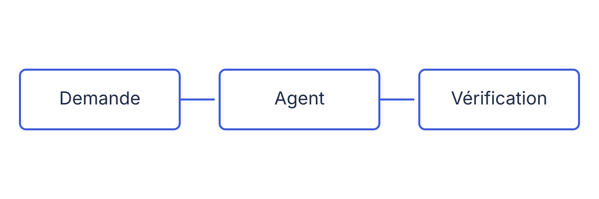

# Code et outils

Objectif du module, en une phrase.

## Bloc de code

```python
from dataclasses import dataclass


@dataclass
class Commande:
    reference: str
    montant: float

    def avec_tva(self, taux: float = 0.2) -> float:
        return round(self.montant * (1 + taux), 2)
```

## Explication et code {kicker="Deux colonnes"}

La ligne `|||` coupe le corps en deux colonnes.

- `avec_tva` arrondit au centime
- le taux par défaut vaut 0,2

|||

```python
def avec_tva(self, taux: float = 0.2) -> float:
    return round(self.montant * (1 + taux), 2)
```

## Session terminal

```console
$ python3 --version
Python 3.10.12
$ python3 -m pytest -q
....                                                   [100%]
4 passed in 0.02s
```

## Fichier de contexte {.compare}

::: claude-code
[Comportement dans Claude Code]

```console
$ claude
```
:::

::: opencode
[Comportement dans Open Code]

```console
$ opencode
```
:::

::: sources
- [Documentation Claude Code](https://example.org/claude-code)
- [Documentation Open Code](https://example.org/opencode)
:::

## Tableau

| Action | Claude Code | Open Code |
|---|---|---|
| [Action n°1] | `[commande]` | `[commande]` |
| [Action n°2] | `[commande]` | pas d'équivalent |

## Schéma



## TP 2 : prise en main {.tp duration="45 min"}

Objectif du TP, en une phrase : ce que le stagiaire sait faire à la fin.

Prérequis : le projet fil rouge est copié dans `~/fil-rouge`.

::: notes
Passer entre les postes. Vérifier le modèle utilisé par chacun.
:::

### Lancer l'outil dans le projet

```console
$ cd ~/fil-rouge
```

::: claude-code
```console
$ [commande de lancement de Claude Code]
```
:::

::: opencode
```console
$ [commande de lancement d'Open Code]
```
:::

::: attendu
L'outil affiche son invite et le répertoire de travail `~/fil-rouge`.
:::

### Demander une vue d'ensemble

Envoyer ce prompt :

```prompt
Décris l'architecture de ce projet : modules, dépendances entre eux, point d'entrée.
```

::: attendu
Une description qui cite les modules du dossier `src/`.
:::

::: indice
Si la réponse reste générale, demander de citer les fichiers lus.
:::

### Lancer les tests

```console
$ python3 -m pytest -q
....                                                   [100%]
4 passed in 0.02s
```

::: attendu
Tous les tests passent.
:::

### Corrigé {.corrige}

Le code est repris du fichier testé :

```python file="code/commande.py"
```
