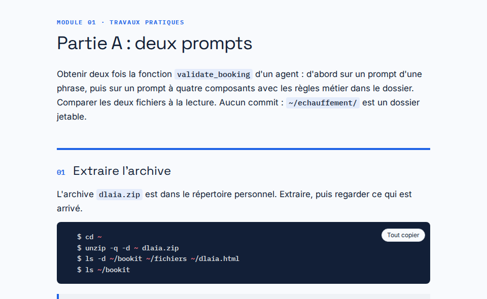

# Ouverture

## Développement logiciel assisté par l'IA {.title kicker="Formation"}

Piloter un agent de code

::: notes
Accueil, horaires, pauses, tour de table : attentes, outils déjà utilisés, projets en cours.
:::

## Programme {.agenda days="4" kicker="Programme"}

::: notes
Lecture de la slide : une colonne par jour, de haut en bas dans l'ordre du temps. Jour 1, modules 1 à 4 : piloter l'agent, cadrer, spécifier. Jour 2, modules 5 à 8 : planifier, implémenter, vérifier, garder le recul.
Les titres de modules (Constitution, Spec Driven Development, Spec Kit) sont annoncés ici, définis dans leur module : ne pas les expliquer maintenant.
:::

## Jour 1 : piloter, cadrer, spécifier {kicker="Programme"}


::: notes
Lire la colonne de haut en bas : c'est l'ordre du temps. Un bloc gris est un exposé, un bloc bleu un TP.
Le TP 1 couvre les modules 1 et 2 : partie A après le module 1, partie B après le module 2. Il n'y a pas de TP 2.
Le jour se termine par le bilan : projection de la carte mentale de la formation.
Horaires et pauses : à donner à l'oral, aucune durée n'est affichée.
:::

## Jour 2 : planifier, implémenter, vérifier {kicker="Programme"}


::: notes
Même lecture que le jour 1. Le module 6 est coupé en deux : le TP 6 partie A (implémentation) tombe au milieu, la partie B (mutation testing) à la fin.
Pas de TP aux modules 7 et 8 : exposés. Le jour se termine par le bilan et l'évaluation.
:::

## Chaque TP met en pratique le module qui le précède. {.statement kicker="Programme"}

::: notes
Conclut les trois slides du programme : à chaque bloc bleu, le stagiaire refait avec l'agent ce que le bloc gris vient d'exposer.
:::

## Deux agents de code {.compare kicker="Agent et modèle"}

::: claude-code
Agent de code en ligne de commande d'Anthropic.

```console
$ claude
```
:::

::: opencode
Agent de code libre en ligne de commande, version 2.

```console
$ opencode
```
:::

::: sources
- [Claude Code, Overview](https://code.claude.com/docs/en/overview)
- [Open Code, Intro](https://opencode.ai/docs/)
:::

::: notes
Sources consultées : la page Overview de Claude Code installe l'outil et le lance par `claude` dans un dossier de projet ; la page Intro d'Open Code le présente comme « an open source AI coding agent » lancé par `opencode`.
Les deux outils sont installés et configurés sur la VM, aucune installation à faire. Version 2 d'Open Code : celle de la VM (v2.0.32 relevée le 19 octobre 2026, `formateur/fil-rouge.md`) ; la page Intro dit que OpenCode 1 et OpenCode 2 utilisent la commande `opencode` et que la v2 est disponible.
Chaque TP donne la variante de chaque agent de code quand elles diffèrent : commande, lancement, `/clear` contre `/new`. Le stagiaire choisit son agent sur la page du TP et suit l'autre variante des yeux seulement s'il le souhaite.
:::

## Claude Sonnet 4.6, modèle unique {kicker="Agent et modèle"}


Toutes les sorties du support viennent de Claude Sonnet 4.6, quel que soit l'agent de code.

::: sources
- [Claude Code, Amazon Bedrock](https://code.claude.com/docs/en/amazon-bedrock)
- [Open Code, Providers : Amazon Bedrock](https://opencode.ai/docs/providers/#amazon-bedrock)
:::

::: notes
Sur la VM, aucune clé API à saisir : les identifiants AWS viennent du rôle de la machine (configuration de la formation, pas un fait des pages citées).
Claude Code : la page Amazon Bedrock dit qu'il lit la chaîne d'identifiants par défaut du SDK AWS (profil, variables d'environnement, rôle de l'instance) ; la région suit `AWS_REGION`, `AWS_DEFAULT_REGION`, puis le profil. Sans épinglage, son modèle par défaut sur Bedrock est Claude Opus 5.5. Les pages citées établissent le fournisseur, les identifiants et l'existence de Sonnet 4.6 sur Bedrock ; le choix de `claude-sonnet-4-6` sur la VM est un choix de la formation (`formateur/fil-rouge.md`).
Open Code : la page Providers, section Amazon Bedrock, donne le fournisseur `amazon-bedrock` et ses identifiants AWS (profil, clés d'accès, rôle ; un jeton `AWS_BEARER_TOKEN_BEDROCK` l'emporte s'il existe, absent sur la VM).
Un seul modèle dans les deux agents rend les sorties comparables d'un outil à l'autre. L'alias `sonnet` n'est jamais utilisé : sur Bedrock il désigne Sonnet 4.5 tant que `ANTHROPIC_DEFAULT_SONNET_MODEL` n'est pas défini (page Claude Code, Amazon Bedrock).
:::

## Chaque TP se réalise avec l'un ou l'autre agent de code. {.statement kicker="Agent et modèle"}

::: notes
Conclut les deux slides précédentes : même modèle, deux agents de code. Le choix de l'agent se fait une fois sur la page de TP et vaut pour tous les TP.
:::

## Le fil rouge : bookit {kicker="Fil rouge"}

### Fourni

Une application de réservation de ressources.

|||

### À construire

`validate_booking`, qui accepte ou refuse une réservation. Du TP 3 au TP 6, bookit grandit : chaque TP part de l'état d'arrivée du précédent.

|||


::: notes
Le fil rouge est le projet bookit, repris de TP en TP. La présentation complète (concepts, règles, squelette, ce que chaque TP ajoute) est au module 3, avant le TP 3 : ne pas la faire ici.
Le TP 1 reste à part : dossier jetable, `validate_booking` demandé à l'agent sans méthode, pour comparer avec le reste.
Le stagiaire travaille sur une seule copie de bookit du début à la fin et termine chaque TP avant le suivant.
Seuls les verbes sont annoncés : un verbe par séquence, repris des titres des jours 1 et 2. Le TP 6 est le dernier jalon : il livre le code et sa vérification.
Il n'y a pas de TP 2 : le TP 1 couvre les modules 1 et 2. Le détail de ce que chaque TP ajoute à bookit vient au module 3.
:::

## L'archive et la page de TP {kicker="Démarrage"}

### `dlaia.zip`

- `dlaia.html` : le support, ce cours compilé
- `bookit/` : le fil rouge
- `fichiers/` : les fichiers que les TP font copier

|||



L'énoncé d'un TP se lit sur cette page, à côté du terminal.

|||

::: notes
Le support est le fichier `dlaia.html` : il s'ouvre dans un navigateur, sans serveur. Il est aussi publié sur la VM.
L'extraction de l'archive (`unzip -d ~`, travail dans `~/bookit/`) est la première étape du TP 1 : ne pas la faire ici.
Chaque fichier que l'énoncé d'un TP fait copier vit dans `fichiers/`, et nulle part ailleurs.
Chaque TP a une slide de lancement projetée en salle et une page d'énoncé qui défile : pastille « TP » dans la barre de navigation, Échap pour revenir aux slides. La page se lit en demi-écran, à côté du terminal.
Montrer : le choix de l'agent de code en haut à droite (Claude Code ou Open Code, retenu pour tous les TP) ; le bouton « Tout copier » de chaque bloc de code ; le bloc « Résultat attendu » sous chaque étape ; l'indice replié ; la case « Étape terminée » et le compteur d'étapes. Les cases cochées restent dans le navigateur.
Le texte de la page s'appelle l'énoncé.
:::

## Glossaire : agents de code {kicker="Glossaire"}

- **Agent de code** : programme en ligne de commande qui pilote un modèle pour lire, écrire et exécuter du code dans un dépôt
- **Claude Code** : agent de code d'Anthropic en ligne de commande
- **Open Code** : agent de code libre en ligne de commande, version 2

::: notes
Slide de référence, à ne pas lire en salle. Définitions du lexique de la formation.
:::

## Glossaire : modèle {kicker="Glossaire"}

- **Claude Sonnet 4.6** : modèle unique, `claude-sonnet-4-6`
- **Amazon Bedrock** : service d'Amazon Web Services qui héberge des modèles, appelé par les deux agents de code

::: sources
- [Claude Code, Amazon Bedrock](https://code.claude.com/docs/en/amazon-bedrock)
:::

::: notes
Slide de référence, à ne pas lire en salle. Définitions du lexique de la formation.
:::

## Glossaire : TP et support {kicker="Glossaire"}

- **TP** : travaux pratiques, pratique guidée à la suite d'un module
- **Énoncé** : texte d'un TP, sur sa page dédiée
- **Support** : le cours compilé, `dlaia.html`

::: notes
Slide de référence, à ne pas lire en salle. Définitions du lexique de la formation.
:::

## Glossaire : bookit et archive {kicker="Glossaire"}

- **bookit** : application de réservation de ressources
- **Fil rouge** : projet bookit repris de TP en TP
- **Archive** : `dlaia.zip`, qui contient le support, `bookit/` et `fichiers/`

::: notes
Slide de référence, à ne pas lire en salle. Définitions du lexique de la formation.
:::
